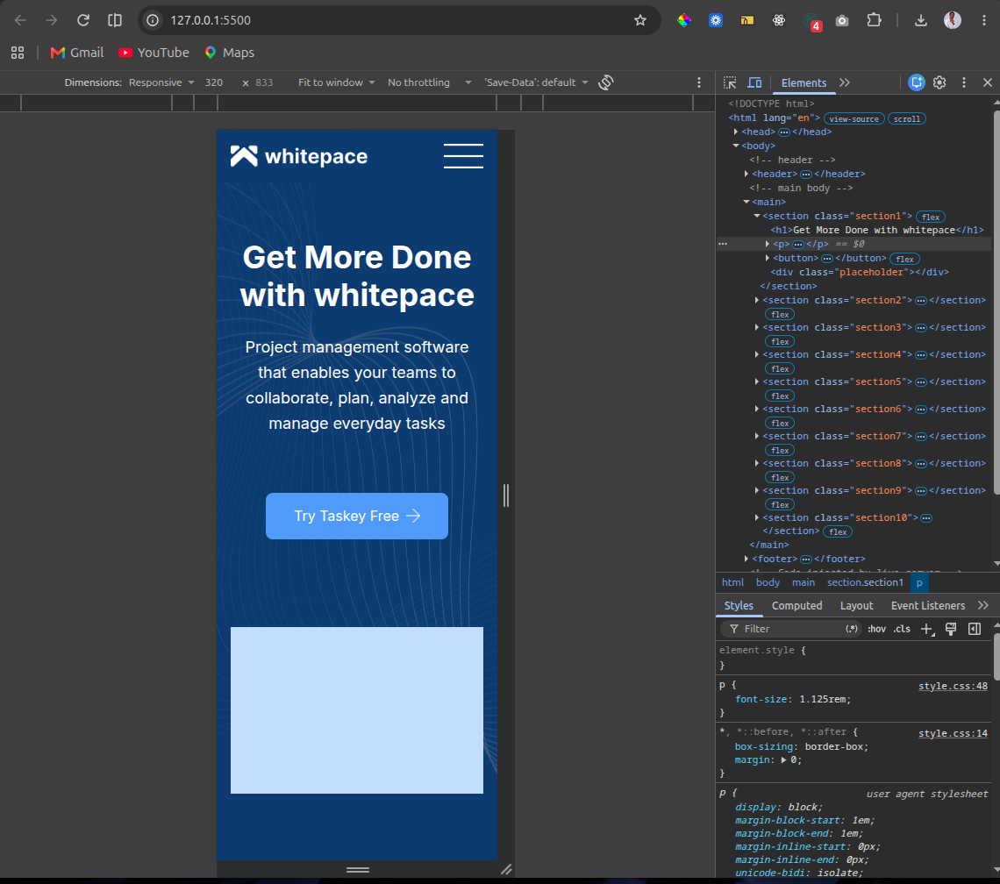
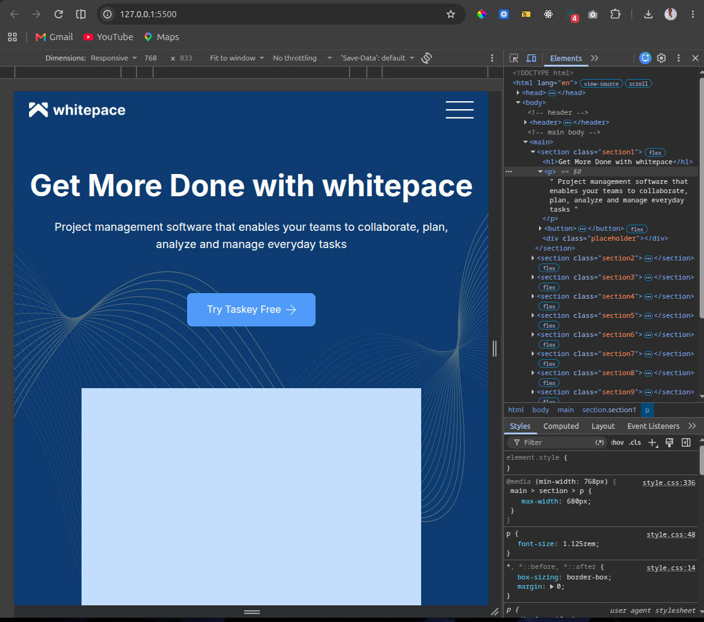
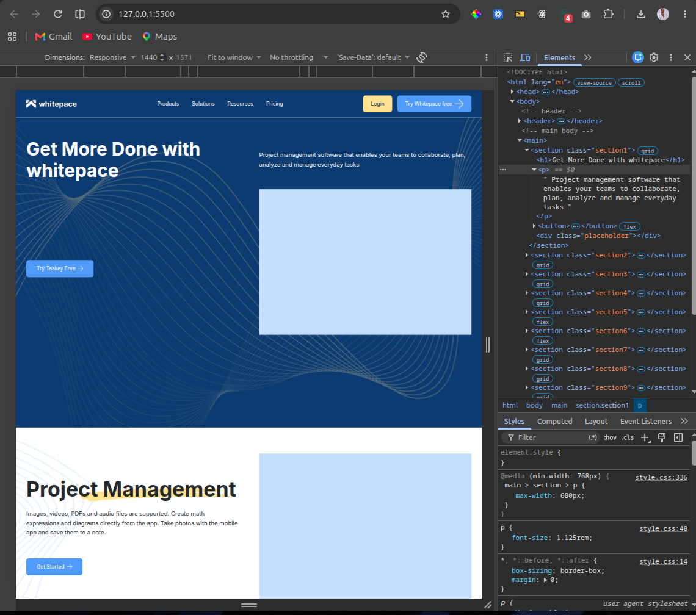

# Whitepace Landing Page

This is a responsive replica of the Whitepace SaaS landing page, built from a Figma design with HTML and CSS only. It is written mobile first, then enlarged for tablet and desktop screens.

## Overview

The project turns a Figma design into a single long page, from the header to the footer. Every section is built with real HTML and CSS. Only illustrations, logos and icons are images exported from Figma. There is no JavaScript, so every state and layout change is done with CSS.

## Project Goals

- Rebuild every section of the Figma page, from the hero to the footer.
- Write the base CSS for mobile, then add `min-width` media queries for tablet (768px) and desktop (1024px and above).
- Use semantic HTML5 and meaningful alt text.
- Use Flexbox and Grid for layout, with colors and fonts stored as CSS custom properties.
- Work on a feature branch, open a pull request into `main` and deploy the page.

## Tech Stack

- HTML5 and CSS3 (Flexbox, Grid, custom properties and media queries)
- Google Fonts (Inter)
- Figma, for measuring the design and exporting assets
- Git and GitHub, with GitHub Pages for deployment
- GitHub Actions with Super-Linter
- Ubuntu terminal, VS Code with Live Server

## What Works

- Header with the logo and the menu icon.
- Hero section with the main heading, text and call to action button.
- Project Management and Work Together sections.
- Use As Extension and Customise It To Your Needs sections.
- Pricing section ("Choose Your Plan") with the plan card.
- "Your work everywhere you are", "100% your data" and Our Sponsors sections.
- Apps integration section and the testimonial ("What Our Clients Says").
- Final call to action and the full footer with the link columns, the language selector and the social icons.
- Layout that adapts at 320px, 768px and on desktop, with no horizontal scrolling.
- Hover and focus states on buttons and links, written in CSS only.

## What Is Not Done

- Only one testimonial card is shown. The other testimonials are not added.
- The page does not use JavaScript, so there is no slider. The dots under the cards are an image.
- The page matches the Figma frames closely, but not pixel for pixel.

## Testing

1. Open the page and use the browser device toolbar (`Ctrl+Shift+M`) at 320px, 768px and 1440px.
2. Compare each section with the matching Figma frame.
3. Check that the page never scrolls sideways. In the console, `document.documentElement.scrollWidth === window.innerWidth` must be `true`.
4. Press `Tab` and check that buttons and links show a visible focus style.
5. Check that no image returns a 404 error in the console.
6. Push the branch and check that the Lint Code Base workflow passes.

## Challenges Faced

- **A rule that styled the whole page.** `.section1, h1` uses a comma, which means "section1 or any h1", so it changed every h1 and paragraph. A space (`.section1 h1`) targets only the elements inside the section.
- **Header icons that would not sit at the two ends.** The flex rule was on `header`, but the icons were inside `nav`. Moving `display: flex` and `justify-content: space-between` to `nav` fixed it.
- **Order of rules in mobile first CSS.** A tablet rule only wins if it comes after the base rule it changes, and repeating the same values changes nothing.
- **Matching the Figma values.** Colors, spacing and font sizes had to be read from each frame, and every size was checked at 320px, 768px and on desktop.

## What I Learned

- Choosing between a comma list and a descendant selector.
- Building mobile first, with `min-width` media queries added after the base styles.
- Stacking content with Flexbox columns and `gap`, and using Grid for multi column sections.
- Storing colors and fonts in CSS custom properties.
- Exporting assets from Figma and linking them with relative paths.
- Writing semantic HTML with alt text that describes the image.

## Screenshots

## Author

Ntein Praises, Full Stack Developer
